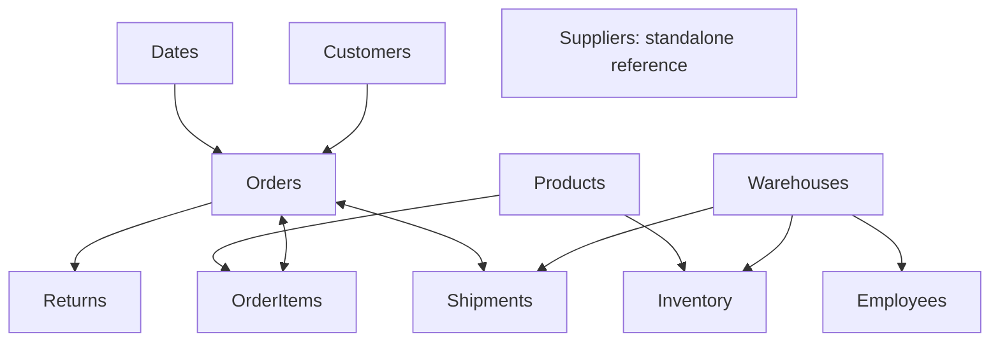

# SwiftLog Logistics Analytics

**Iyiola Anjolaoluwa Emmanuel**  
Data Analytics, AnalystLab Africa, Week 5  
Reporting period: **1 January - 8 September 2026**

SwiftLog's supplied logistics data connects customer orders with products, warehouses, inventory movements, shipments and returns. The project examines commercial activity and service performance, with explicit definitions for measures that the available fields can support.

## Main findings

- The source contains **5,000 orders**, **15,000 order items**, **1,000 customers**, **250 products** and **5,000 shipments**.
- Delivered catalogue value totals **7,107,470.53 price units**. Currency, realised sale prices and recognised revenue are unspecified. **236 orders**, including 80 marked Delivered, have no item records.
- The recorded on-time rate is **36.28%**, and average recorded delay is **3.57 days**. All source On Time labels correspond to delays of 0-2 days. The zero-delay share is **12.22%**.
- Kano has the highest recorded delayed share at **65.66%**. Warehouse workload ranges from **19.93** shipments per employee at W13 to **37.78** at W14. These are descriptive comparisons.
- **500 return events** relate to **473 distinct orders**, an order-level association rate of **9.46%**. Returned products and quantities are unidentified.
- **264** of **2,455** observed warehouse-product aggregates fall below an illustrative 100-unit threshold. The undated aggregate inventory quantity is **1,007,764**.
- August has the highest monthly count at **654 orders**. April has the highest daily activity among complete months at **21.27 orders per day**. September covers eight days.

## Deliverables

| File or directory | Purpose |
| --- | --- |
| [Complete project archive](SwiftLog_Project.zip) | All 314 project files, including the complete native Power BI report and semantic model. |
| [Executive BI report](Report/Executive_BI_Report.pdf) | Five-page leadership report with findings, limitations and ten evidence-based recommendations. |
| [Executive presentation](Presentation/Executive_Presentation.pptx) | Fourteen slides with editable charts and tables. |
| [Analytical page previews](Report/Dashboard_Preview.pdf) | Five static analytical views of the supplied data. |
| [Interactive analytical dashboard](Dashboard/SwiftLog_Dashboard.html) | Self-contained browser report with five pages and shared filters. |
| [Power BI project source](SwiftLog_Project.zip) | Native report definitions and an import-mode semantic model. |
| Data/Original_Datasets | Unmodified original CSV datasets and the supplied dictionary. |
| Data/Processed | Prepared tables at their documented reporting grains. |
| Analysis | Summary outputs, KPI definitions, source profiling and executed reconciliations. |
| References | Source attribution and the project field dictionary. |
| src | Reproducible data preparation, report and dashboard builders. |

## Data preparation and analytical approach

The pipeline trims text, parses OrderDate explicitly as month/day/year, checks primary and foreign keys, and verifies non-negative values. Source columns contain no missing values. Order-item, customer, product and shipment joins preserve their intended grain.

Delivered value uses Quantity multiplied by the supplied catalogue UnitPrice, limited to Delivered status orders. The average value denominator includes only priced delivered orders. Unpriced baskets remain identifiable through HasItems rather than being interpreted as observed zero-value orders.

Return events remain separate from distinct returned orders. Product return association measures the share of orders containing a product that also carry a return record. It does not identify the returned product.

All 4,000 inventory rows remain in the movement table, including repeated warehouse-product combinations and three identical source rows. Inventory aggregates sum stock quantities per observed warehouse-product pair, following the official clarification. Unobserved pairs remain unknown.

The Python pipeline passes **43 checks**. Twelve independently written SQLite queries reconcile headline values to pandas with zero relative tolerance and a maximum absolute difference of 0.000001. Source hashes, column profiles and transformation counts are retained with the analytical outputs.

## Power BI model and report

The project defines **14 tables, 12 relationships and 47 measures**. Shared Power Query staging queries contain portable original-source snapshots. Fact queries perform the catalogue joins, order aggregation, return aggregation, stock aggregation and date derivations. The original datasets remain available separately for audit and reproduction.

The five main pages cover executive performance, customer analytics, inventory and warehouses, shipment and delivery, and suppliers and products. Supporting pages define product drill-through and contextual tooltips. The report source includes navigation buttons, synchronised slicers, bookmarks, dynamic titles, conditional colour measures, mobile visual positions and an adjustable low-stock parameter.

Customer and date dimensions filter orders. Order-item and shipment relationships support bidirectional propagation to the order table so product and warehouse selections can affect order-level measures. Other dimension relationships use one direction. Suppliers remain a standalone reference table.



[Measures.dax](Dashboard/Measures.dax) and [KPI_Definitions.csv](Analysis/KPI_Definitions.csv) document formulas, denominators and business meanings. [PowerQuery.m](Dashboard/PowerQuery.m) records the source and transformation expressions.

## Reproducibility

The analytical environment uses Python 3.12.14. Package versions are pinned in requirements.txt.

```bash
python -m pip install -r requirements.txt
python src/analysis.py
python src/build_dashboard.py
python src/build_powerbi.py
python src/build_report.py
```

Download and extract [SwiftLog_Project.zip](SwiftLog_Project.zip) to obtain the complete project, including the native Power BI report definitions. Run commands from the extracted project root. The analysis uses an in-memory SQLite database and does not require a database service. The browser dashboard embeds its reporting data and works without an internet connection. Its month, customer-city, warehouse, category and order-status selections persist across pages. Saved views use browser-local storage.

Open Dashboard/SwiftLog_Analytics.pbip in Power BI Desktop to load the native project. The semantic model embeds its source snapshots, so it does not depend on a machine-specific data path. Running build_powerbi.py rebuilds those snapshots from the original files and recreates the generated report definitions.

Inventory quantities respond to warehouse and product selections. They have no date or customer-city basis. The browser inventory view states this distinction. The low-stock parameter is an illustrative planning control rather than an established replenishment policy.

## Assumptions and Data Limitations

- Catalogue value is an analytical estimate. Currency, actual selling prices, costs, discounts and revenue recognition are unspecified.
- Recorded on-time status follows the source label. The observed 0-2 day rule does not establish a contractual service-level agreement.
- OrderDate defines shipment and return cohorts. Dispatch, promised-arrival, actual-arrival and return dates are absent. Total delivery duration cannot be calculated.
- Suppliers have no relationship to products, orders or shipments. A supplier performance score cannot be estimated.
- Inventory has no dates, opening/closing balances, movement direction or warehouse capacity. Aggregate quantities do not establish current stock, standard turnover or physical utilisation.
- Return records identify orders rather than returned products. Furthermore, 315 return-associated orders currently have Pending or Cancelled status. Lifecycle timing cannot be reconciled from the supplied fields.
- Repeat purchasing describes the observation window. It does not establish longitudinal retention. Customer city is a destination proxy.
- September contains only eight observed days.

The unsupported numeric KPIs return BLANK in the semantic model. Their definitions explain the missing fields. Descriptive proxies have separate names and are not presented as physical utilisation, standard turnover or verified supplier performance.

## Sources

The project uses the AnalystLab Africa Week 5 Data Analytics brief, supplied SwiftLog datasets and official dataset clarification dated 13 October 2026. Full links appear in [References/Sources.md](References/Sources.md). Field definitions appear in [References/Data_Dictionary.md](References/Data_Dictionary.md).
